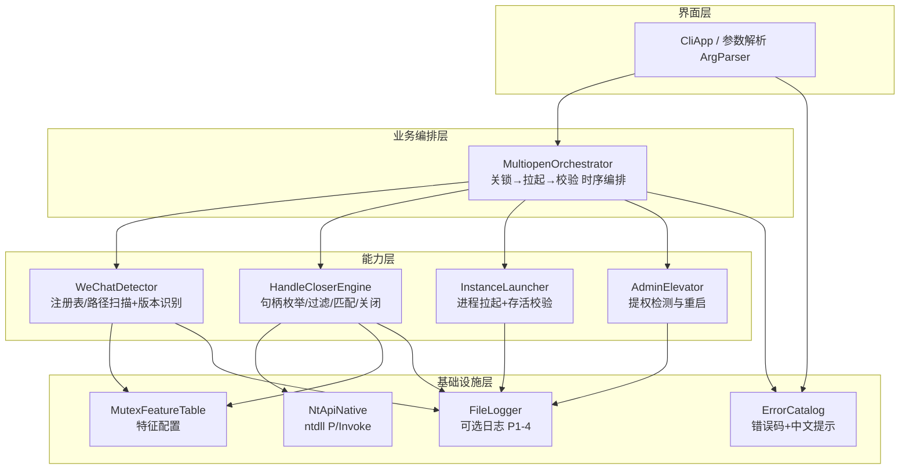

# 微信 PC 端多开工具 — 架构设计

**架构师**：高见远（Gao）｜**版本**：v1.0｜**对应 PRD**：01-PRD.md（MVP 范围）

## 1. 实现方案与技术选型

### 1.1 核心技术挑战

1. **句柄枚举为未公开 API**：核心依赖 ntdll 的 NtQuerySystemInformation / NtQueryObject，需精确的 x64 结构体 marshaling（指针宽度 8 字节），任何结构体对齐错误都会导致解析垃圾数据或崩溃。
2. **NtQueryObject 挂起问题**：对某些句柄（典型：命名管道对端、被挂起的 IO 句柄）调用 NtQueryObject(ObjectNameInformation) 可能永久阻塞，必须有超时/跳过策略。
3. **跨进程句柄复制**：需对微信进程持 PROCESS_DUP_HANDLE 权限 OpenProcess，在 64 位系统上用 SystemExtendedHandleInformation（类值 64）获取 SYSTEM_HANDLE_TABLE_ENTRY_INFO_EX。
4. **权限与时序**：关闭互斥体需要管理员权限；关闭后到新实例启动之间存在竞态窗口，需"关锁→立刻拉起→校验存活"的紧凑时序。
5. **分发与杀软误报**：涉及进程/句柄操作的独立 exe 是杀软误报重灾区，需单文件、无脚本依赖、可签名。

### 1.2 技术栈选型与论证

| 方向 | 结论 | 理由 |
|------|------|------|
| **C# / .NET 8（选定）** | ✅ 采用 | ① P/Invoke 成熟：DllImport/LibraryImport 声明 ntdll API 简洁，struct layout（Pack=1、LayoutKind.Explicit）可控；② `dotnet publish -r win-x64 -p:PublishSingleFile=true --self-contained` 单文件免安装，可加 `-p:PublishAot=true`（NativeAOT）产出 ~3-5MB、无运行时依赖、启动 <100ms；③ 异常处理/字符串/JSON（System.Text.Json 读特征表）开箱即用；④ 杀软误报率显著低于 Python 打包（pyinstaller 是误报重灾区）；⑤ 维护成本远低于 C++ |
| C++ / Win32 | ❌ 不采用 | 最轻量但结构体解析、字符串处理、JSON 解析全要手写，MVP 周期内开发与后续适配成本过高 |
| Python + ctypes | ❌ 不采用 | 分发需打包解释器（PyInstaller 体积 20MB+），杀软误报率极高，且 Nt 结构体解析在 ctypes 下更易出错 |

**架构模式**：分层 + 单一职责的 CLI 程序（无 GUI 框架）。层级：`CLI 界面层 → 业务编排层（MultiopenOrchestrator）→ 能力层（检测器/句柄引擎/启动器/提权器）→ 基础设施层（Nt API Native 封装 / 配置 / 日志 / 错误码）`。

**关键技术决策**：
- D1：句柄枚举用 `NtQuerySystemInformation(SystemExtendedHandleInformation=64)` 而非 SystemHandleInformation(16)——后者在 x64 上结构体指针字段会截断，必须用 Ex 版本。
- D2：句柄名获取采用"先复制到本进程再查询"策略：`DuplicateHandle(源进程, h, 本进程, &hCopy, 0, FALSE, DUPLICATE_SAME_ACCESS)` 后对 hCopy 查询，避免直接操作源进程句柄引发挂起/崩溃；且**只对 ObjectType==Mutant 的句柄查询名称**（先 NtQueryObject(ObjectTypeInformation=2) 拿类型名，非 Mutant 直接跳过），大幅降低管道句柄挂起概率。
- D3：对 Mutant 句柄的名称查询仍放独立 Task + 2s 超时（挂起则放弃该句柄，记 DEBUG 日志），彻底兜底。
- D4：互斥体名称特征放 JSON 配置（内嵌资源 + 可选外部文件覆盖），含版本分支 → 名称模式列表 + 句柄类型，满足 P1-3。
- D5：提权采用 app.manifest 声明 `requireAdministrator`（启动即触发 UAC，符合 PRD Q4 建议方向），并保留代码级 IsElevated 检测 + `runas` verb 重启自身作为兜底。

## 2. 系统模块划分



各模块职责：
- **WeChatDetector**（P0-1、P1-2）：读注册表 `HKCU\Software\Tencent\WeChat`（3.x，InstallPath）与 `HKCU\Software\Tencent\Weixin`（4.x，InstallPath），回退扫描 `%ProgramFiles%\Tencent\WeChat\WeChat.exe`、`%ProgramFiles%\Tencent\Weixin\Weixin.exe` 及 `HKLM\...\Uninstall` 项；用 FileVersionInfo.GetVersionInfo 取版本号；按 exe 名（WeChat.exe→3.x / Weixin.exe→4.x）判定分支并从特征表加载对应互斥体名称集。
- **HandleCloserEngine**（P0-2、P1-1）：枚举系统句柄→按 PID 过滤→按类型过滤→查名匹配→关闭；支持对已运行实例执行（P1-1）。
- **InstanceLauncher**（P0-3）：Process.Start(exePath)，轮询 `Process.HasExited` + `MainWindowHandle != IntPtr.Zero`（超时 25s）校验窗口就绪；检测"启动即退出"（多开失败的典型表现）。
- **AdminElevator**（P0-5、P1-2）：WindowsIdentity.GetCurrent() 判管理员角色；未提权时用 `new ProcessStartInfo{ Verb="runas" }` 重启自身并传递原参数，拒绝提权则输出中文指引。
- **MultiopenOrchestrator**：把上述能力串成核心流程（见 §3 时序图），控制"关闭已运行实例互斥体（若有）→ 循环 N 次：关锁→拉起→校验"。
- **CliApp / ArgParser**（P0-4、P0-6、P1-2、P1-4）：解析 -n/--count、-p/--path、--doctor、--log、--help；--help 与首次运行输出合规声明。
- **NtApiNative**：全部 ntdll/kernel32 P/Invoke 声明，唯一允许出现 unsafe/结构体 marshaling 的文件。
- **MutexFeatureTable**（P1-3、P2-4）：JSON 特征表加载器（内嵌默认表 + `mutex_features.json` 外部覆盖）。
- **ErrorCatalog**（P0-5）：错误码→(原因, 建议) 中文映射，CLI 只输出友好文案不输出堆栈。
- **FileLogger**（P1-4）：`--log` 时写 `multiopen.log`（时间、微信版本、各步骤结果）。

## 3. 核心算法流程（句柄关闭法时序图）

```mermaid
sequenceDiagram
    participant CLI as CliApp
    participant ORC as MultiopenOrchestrator
    participant ELV as AdminElevator
    participant DET as WeChatDetector
    participant ENG as HandleCloserEngine
    participant NT as NtApiNative(ntdll)
    participant LCH as InstanceLauncher
    participant OS as Windows OS

    CLI->>CLI: 解析参数(-n/-p/--doctor/--log)
    CLI->>CLI: 首次运行/--help 输出合规声明
    CLI->>ELV: IsElevated()
    ELV-->>CLI: false→runas重启自身/给出指引; true→继续
    CLI->>DET: Detect(pathOverride?)
    DET->>OS: RegGetValue(HKCU\Software\Tencent\WeChat|Weixin)
    DET->>DET: FileVersionInfo取版本, 按exe名选分支(3.x/4.x)
    DET-->>ORC: WeChatInfo{Path, ExeName, Version, Branch}
    DET-->>CLI: 未找到→ERR101"未检测到微信"中文提示+退出

    loop 对每个实例 i = 1..N
        ORC->>DET: FindRunningProcesses(branch)
        DET->>OS: 枚举进程(Process.GetProcessesByName)
        DET-->>ORC: 微信进程PID列表(可为空)

        alt 存在已运行实例(P1-1) 或 i≥1(启动前必须再次关锁)
            ORC->>ENG: CloseMutexes(pids, featureTable)
            ENG->>NT: NtQuerySystemInformation(SystemExtendedHandleInformation=64)
            NT-->>ENG: SYSTEM_HANDLE_INFORMATION_EX(全系统句柄表)
            ENG->>ENG: 过滤: PID∈微信进程 且 ObjectType=="Mutant"
            loop 对每个候选Mutant句柄(带2s超时)
                ENG->>NT: OpenProcess(PROCESS_DUP_HANDLE=0x0040, PID)
                ENG->>NT: DuplicateHandle(源,h,本进程,&hCopy,0,FALSE,DUPLICATE_SAME_ACCESS)
                ENG->>NT: NtQueryObject(hCopy, ObjectNameInformation=1)
                NT-->>ENG: UNICODE_STRING{名字}
                ENG->>ENG: 名称匹配特征表模式(_WeChat_App_Instance_Identity_Mutex_Name 等)
                alt 匹配成功
                    ENG->>NT: DuplicateHandle(源,h,NULL,NULL,0,FALSE,DUPLICATE_CLOSE_SOURCE|DUPLICATE_SAME_ACCESS)
                    NT-->>ENG: 互斥体已在源进程关闭→记日志
                else 名称查询超时/不匹配
                    ENG->>ENG: 关闭本进程hCopy, 跳过该句柄
                end
            end
            ENG-->>ORC: CloseResult{尝试数/关闭数/失败明细}
        end

        ORC->>LCH: Launch(wechatPath, timeout=25s)
        LCH->>OS: Process.Start(wechatPath)
        LCH->>OS: 轮询 HasExited / MainWindowHandle(每500ms)
        alt 进程存活且窗口出现
            LCH-->>ORC: 实例i启动成功
        else 启动即退出(仍检测到互斥体或被拦截)
            LCH-->>ORC: 失败→重试关锁1次→再失败则按ERR30x/ERR40x输出原因
        end
    end
    ORC-->>CLI: 汇总: 成功M个/N个, 版本信息, 日志路径
    CLI-->>CLI: 输出中文结果与合规提示, exit code
```

**关键时序要点**：
1. **每次拉起前都要关锁**（i≥1 必关）：新实例启动时会 CreateMutex——若互斥体已存在则旧逻辑是"检测到已运行→激活已有实例后退出"，这就是多开失败的机制，所以"关锁→立即拉起"必须紧凑，中间不留间隙。
2. 关闭后微信旧实例并不受影响：它持有的互斥体句柄被强制关闭后，旧实例不依赖该句柄做消息收发；但需在评审项中监控（见评审报告风险 R5）。
3. N 遍循环里句柄枚举每次重做（系统句柄表实时变化），单次枚举目标 ≤5s（PRD 性能指标），缓存进程 PID 列表减少无效遍历。

## 4. 关键数据结构与接口

```csharp
// ---- 数据模型 ----
public enum WeChatBranch { V3, V4 }   // WeChat.exe=V3, Weixin.exe=V4

public sealed record WeChatInfo(string ExePath, string InstallDir, string ExeName,
    string FileVersion, WeChatBranch Branch);

public sealed record MutexFeature(string NamePattern, string HandleType = "Mutant",
    string? Comment = null);   // NamePattern 支持 * 通配(默认整名相等, 大小写不敏感)

public sealed record BranchFeature(WeChatBranch Branch, string[] ExeNames,
    MutexFeature[] Mutexes);   // ExeNames: ["Weixin.exe"]

public sealed record FeatureTable(string SchemaVersion, BranchFeature[] Branches);

public sealed record CloseResult(int Candidates, int Closed, List<HandleFailure> Failures);
public sealed record HandleFailure(int Pid, IntPtr Handle, string Reason); // Reason: OpenFailed/QueryTimeout/NameMismatch/DupFailed

public sealed record LaunchResult(bool Success, int? ExitCode, string? FailReason);

public sealed record OperationReport(int Requested, int Succeeded, WeChatInfo? WeChat, List<string> Errors);

// ---- Nt 层结构（x64, 均为 blittable / 显式布局）----
[StructLayout(LayoutKind.Sequential)]
struct UNICODE_STRING : IDisposable { public ushort Length; public ushort MaximumLength; public IntPtr Buffer; /* RtlZeroMemory+RtlFreeUnicodeString */ }

[StructLayout(LayoutKind.Sequential)]
struct SYSTEM_HANDLE_TABLE_ENTRY_INFO_EX {
    public IntPtr Object;          // 8B
    public IntPtr ProcessId;       // 8B (ULONG_PTR)
    public IntPtr Handle;          // 8B
    public uint GrantedAccess;     // 4B
    public ushort CreatorBackTraceIndex;
    public ushort ObjectTypeIndex; // SystemExtendedHandleInformation 下为类型索引
    public uint HandleAttributes;
    public uint Reserved;
}

// ---- 核心 P/Invoke（NtApiNative 内）----
[DllImport("ntdll.dll")] static extern uint NtQuerySystemInformation(int cls /*64=SystemExtendedHandleInformation*/,
    IntPtr buf, int len, out int returnLen);   // 返回 0xC0000004(STATUS_INFO_LENGTH_MISMATCH) 时扩容重试, 初次 buf = 句柄数估算

[DllImport("ntdll.dll")] static extern uint NtQueryObject(IntPtr handle, int cls /*1=ObjectNameInformation, 2=ObjectTypeInformation*/,
    IntPtr buf, int len, out int returnLen);

[DllImport("kernel32.dll", SetLastError=true)] static extern bool DuplicateHandle(IntPtr hSrcProc, IntPtr hSrc,
    IntPtr hDstProc, out IntPtr hDst, uint desiredAccess, bool inherit, uint options /*DUPLICATE_SAME_ACCESS=2, DUPLICATE_CLOSE_SOURCE=1*/);

[DllImport("kernel32.dll", SetLastError=true)] static extern IntPtr OpenProcess(uint access /*0x0040=PROCESS_DUP_HANDLE*/, bool inherit, int pid);

// ---- 能力层接口 ----
class WeChatDetector {
    WeChatInfo? Detect(string? pathOverride);              // P0-1: pathOverride 优先(P0 用户故事6), 否则注册表→路径回退
    List<int> FindRunningProcesses(WeChatBranch branch);   // 按进程名找已运行实例
}

class HandleCloserEngine {
    CloseResult CloseMutexes(IReadOnlyList<int> pids, BranchFeature feature);
    // 内部: EnumerateHandles → FilterByPid+Type → QueryNameWithTimeout(2s) → Match → Close via DUPLICATE_CLOSE_SOURCE
}

class InstanceLauncher {
    LaunchResult Launch(string exePath, int windowTimeoutMs = 25000);  // P0-3/G3
}

class AdminElevator {
    bool IsElevated();                     // WindowsPrincipal.IsInRole(Administrator)
    int RelaunchElevated(string[] args);   // runas 重启自身, 返回新进程退出码; 用户拒绝→抛 UserDeniedException
}

class MultiopenOrchestrator {
    OperationReport RunAsync(int count, string? pathOverride);  // §3 时序图的编排者
}

class ErrorCatalog {  // P0-5
    public static (string Reason, string Advice) Get(ErrorCode code);
}
```

## 5. 文件列表与目录结构

```
wechat-multiopen/
├─ wechat-multiopen.sln
├─ global.json                          # 锁定 .NET SDK 8.0.x
├─ Directory.Build.props                # 统一 Nullable/LangVersion/版本号
├─ src/
│  └─ WechatMultiopen/
│     ├─ WechatMultiopen.csproj         # PublishSingleFile/AOT 设置 + 内嵌特征表资源
│     ├─ app.manifest                   # requireAdministrator + DPI 感知
│     ├─ Program.cs                     # 入口: 提权→CLI→异常兜底→exit code
│     ├─ Cli/
│     │  ├─ CliApp.cs                   # 命令分发: run/--doctor/--help
│     │  ├─ ArgParser.cs                # -n/-p/--doctor/--log/--help 解析与校验
│     │  └─ ConsoleOutput.cs            # 中文文案/合规声明/用法输出
│     ├─ Core/
│     │  ├─ MultiopenOrchestrator.cs    # 时序编排（§3）
│     │  ├─ WeChatDetector.cs           # 检测器 P0-1
│     │  ├─ HandleCloserEngine.cs       # 句柄引擎 P0-2
│     │  ├─ InstanceLauncher.cs         # 启动器 P0-3
│     │  └─ AdminElevator.cs            # 提权器
│     ├─ Native/
│     │  └─ NtApiNative.cs              # 全部 P/Invoke + 结构体 + 常量
│     ├─ Config/
│     │  ├─ FeatureTable.cs             # 数据模型 + 加载器(内嵌+外部覆盖)
│     │  └─ mutex_features.json         # 3.x/4.x 互斥体特征表(内嵌资源)
│     ├─ Infra/
│     │  ├─ ErrorCode.cs                # 错误码枚举(见 §8)
│     │  ├─ ErrorCatalog.cs             # 错误码→中文(原因,建议)
│     │  ├─ FileLogger.cs               # P1-4 可选日志
│     │  └─ Compliance.cs               # 合规声明文案常量 P0-6
│     └─ Models/                        # WeChatInfo/CloseResult/... 记录类型
├─ tests/
│  └─ WechatMultiopen.Tests/            # xUnit: ArgParser/FeatureTable 匹配/错误码映射单测
│     └─ HandleNameMatcherTests.cs      # 名称匹配逻辑(不依赖真实微信)
├─ scripts/
│  ├─ publish.ps1                       # 一键发布 win-x64 单文件 + 计算 SHA256
│  └─ integration.md                    # 手工集成测试清单(需真机微信)
└─ README.md                            # 用法/合规声明/排障(对应 PRD §7)
```

## 6. 任务列表（供工程师寇豆码按序执行）

| Task ID | 任务名 | 文件 | 依赖 | 优先级 | 对应 PRD |
|---------|--------|------|------|--------|----------|
| T01 | 项目基础设施：解决方案骨架 + 提权清单 + 依赖锁定 | wechat-multiopen.sln, global.json, Directory.Build.props, src/WechatMultiopen/WechatMultiopen.csproj, app.manifest, Program.cs（空壳可编译运行） | — | P0 | 非功能需求（管理员权限、单文件发布前提） |
| T02 | Nt API 基础层 + 互斥体特征配置 | Native/NtApiNative.cs, Config/FeatureTable.cs, Config/mutex_features.json, Models/* | T01 | P0 | P0-2（底层能力）、P1-3（特征配置化） |
| T03 | 微信检测器 + 启动器 + 提权器 | Core/WeChatDetector.cs, Core/InstanceLauncher.cs, Core/AdminElevator.cs | T01 | P0 | P0-1、P0-3（启动部分）、P0-5（提权指引） |
| T04 | 句柄关闭引擎 + 多开编排器 | Core/HandleCloserEngine.cs, Core/MultiopenOrchestrator.cs | T02, T03 | P0 | P0-2、P0-3、P1-1（对已运行实例操作） |
| T05 | GUI 界面 + 错误处理 + 日志 + 自检 + 测试与发布 | GUI/*, Infra/*（ErrorCode/ErrorCatalog/FileLogger/Compliance）, tests/*, scripts/*, README.md | T04 | P0 | P0-4、P0-5、P0-6、P1-2、P1-4 |

说明：T02 与 T03 均只依赖 T01，可并行；T05 为集成收尾（含 xUnit 单测与 publish.ps1 产出 SHA256）。P1-2（--doctor）所需信息（版本/权限/杀软）由 T03 与 Infra 已有能力拼装，实现量小故并入 T05。

## 7. 依赖清单

- **运行时/SDK**：.NET SDK 8.0.x（LTS，global.json 锁定）；目标框架 net8.0-windows；发布 win-x64（优先验证 NativeAOT，若与某 P/Invoke 特性冲突则回退 self-contained 单文件，体积 ~60-70MB 可接受时再优化）
- **第三方包**：`System.CommandLine`（可选，参数不多可手写省依赖）——**MVP 决定：0 第三方 NuGet 依赖**，参数手写解析，全部使用 BCL（System.Text.Json / Microsoft.Win32.Registry / System.Diagnostics.FileVersionInfo / System.Security.Principal），最大程度降低杀软启发式误报与供应链风险
- **构建工具**：dotnet CLI、PowerShell（publish.ps1）、signtool（有证书时签名，PRD §5）
- **测试**：xUnit 2.x（仅测试项目引用，主程序零依赖）

## 8. 共享知识（跨文件约定）

**命名规范**：PascalCase 类/方法；私有字段 `_camelCase`；P/Invoke 结构体名与 Win32 文档严格一致；常量用 Win32 原名（如 `PROCESS_DUP_HANDLE`）并注明十六进制值。

**错误码表**（进程退出码 = 0 成功；失败码便于脚本化调用与排障）：

| 码 | 含义 | 中文提示要点（原因+建议） |
|----|------|--------------------------|
| 0 | 成功 | — |
| 101 | 未检测到微信 | 未找到 WeChat.exe/Weixin.exe；建议用 -p 指定路径或确认已安装 |
| 102 | 微信版本暂不支持 | 版本不在 3.9.x/4.x 适配范围；建议更新特征表或等待适配 |
| 103 | 路径参数无效 | -p 指向的文件不存在或不是微信主程序 |
| 201 | 权限不足且用户拒绝提权 | 需管理员权限；建议以管理员身份重新运行 |
| 301 | 句柄枚举失败 | NtQuerySystemInformation 返回非 0；建议 --doctor 自检 |
| 302 | 未找到/未能关闭互斥体句柄 | 可能特征表过期或被安全软件拦截；建议 --doctor |
| 303 | 句柄名称查询异常（批量） | 仍尝试关闭，提示可能不稳定 |
| 401 | 实例启动失败/闪退 | 新实例启动即退出；建议关闭安全软件实时防护后重试 |
| 402 | 实例窗口超时未就绪 | 25 秒内窗口未出现；建议重试或减少实例数 |
| 500 | 未知错误 | 附带日志路径，引导反馈 |

**日志约定**（P1-4）：仅 `--log` 时启用；文件 `%LOCALAPPDATA%\wechat-multiopen\multiopen.log`；单行格式 `yyyy-MM-dd HH:mm:ss.fff [LEVEL] [步骤] message {k=v,...}`；级别 INFO/WARN/ERROR；记录微信版本、每次 CloseResult 摘要与 LaunchResult。

**互斥体特征配置格式**（Config/mutex_features.json，内嵌默认 + 同目录外部文件覆盖）：

```json
{
  "schemaVersion": "1.0",
  "branches": [
    {
      "branch": "V3",
      "exeNames": ["WeChat.exe"],
      "mutexes": [
        { "namePattern": "_WeChat_App_Instance_Identity_Mutex_Name", "handleType": "Mutant",
          "comment": "微信3.x 多开互斥体（实施时需用 Handle.exe/Process Explorer 在真机核实全名与大小写）" }
      ]
    },
    {
      "branch": "V4",
      "exeNames": ["Weixin.exe"],
      "mutexes": [
        { "namePattern": "_WeChat_App_Instance_Identity_Mutex_Name", "handleType": "Mutant",
          "comment": "4.x 初判沿用同族命名；真实名称以真机观察为准，允许配置多条" },
        { "namePattern": "WeChat*", "handleType": "Mutant", "comment": "4.x 备用宽匹配，宁可多关同类锁也不误伤非 Mutant" }
      ]
    }
  ]
}
```

**其他约定**：所有日期时间 ISO8601 本地时间（纯本机工具，不涉 UTC 换算）；Nt API 返回值统一转 `NtStatus`（uint）后在 NtApiNative 层翻译为 ErrorCode，不向上层泄漏原始码；任何裸异常必须经 Program.cs 顶层 catch 转 ErrorCatalog 文案，不打印堆栈（P0-5）。
